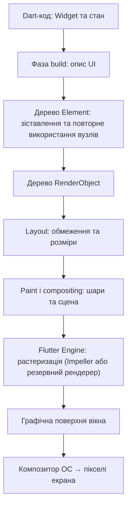
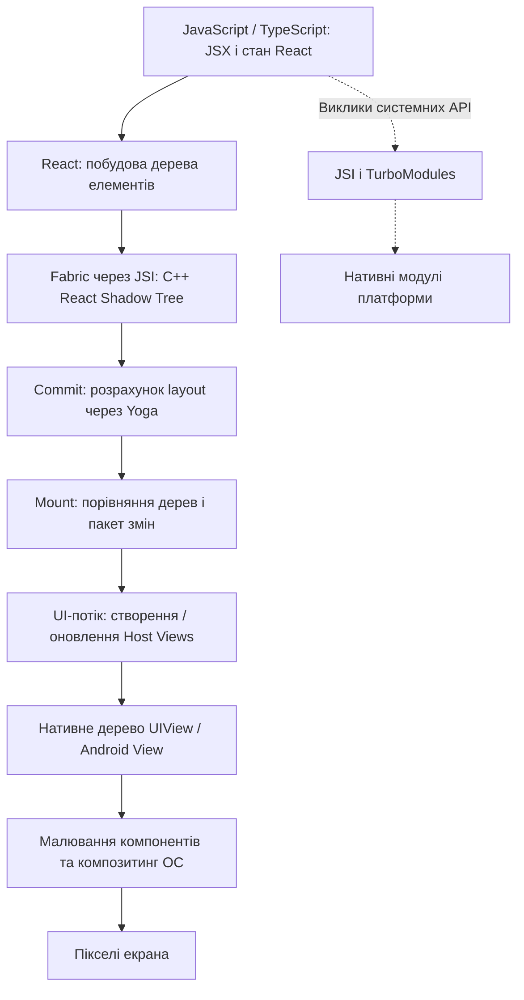

# Практична робота № 2: Технологія Flutter

**Дисципліна:** Програмування для мобільних платформ  
**Тема:** Технологія Flutter  
**Варіант 4:** Порівняльний аналіз архітектур Flutter та React Native  
**Формат:** дослідницький звіт  
**Дата підготовки:** 28 жовтня 2026 року

## 1. Мета роботи

Порівняти Flutter та React Native **на рівні механізмів формування інтерфейсу**, а не за загальними характеристиками. Простежити шлях від коду до пікселів, пояснити історичну роль Bridge в React Native та зміни, які принесли Fabric і нова архітектура. З'ясувати, чому обидва підходи по-різному реагують на зміни системних віджетів, і навести ситуацію, у якій React Native може бути кращим вибором.

## 2. Коротке формулювання головної відмінності

- **Flutter** використовує декларативні `Widget`-об'єкти, власні механізми компонування (`RenderObject`), малювання та растеризації у Flutter Engine. Типові кнопки, поля, картки й анімації не перетворюються на відповідні системні `UIView` або Android `View` — вони малюються Flutter. Для спеціальних випадків можна вбудовувати нативні елементи через *Platform Views* [1, 2].
- **React Native** описує інтерфейс компонентами React (`View`, `Text`, `TextInput` тощо), а рендерер **Fabric** перетворює їх на дерево *host views* платформи. Розрахунок компонування виконує, зокрема, Yoga; створення й оновлення нативних views відбувається на боці ОС [3, 4].

Отже, відмінність не в тому, що один фреймворк «швидкий», а інший «повільний», а в **тому, хто відповідає за зображення UI**: переважно Flutter Engine чи переважно графічна інфраструктура нативних views.

## 3. Шлях від коду до пікселів: Flutter

**Рисунок 1.** Спрощений конвеєр рендерингу звичайного Flutter UI на мобільному пристрої [1, 5].

**Пояснення механізму:**

1. Код на **Dart** описує бажаний стан інтерфейсу як композицію `Widget`. У релізних мобільних збірках Dart-код компілюється наперед (AOT) у машинний код [1, 9].
2. Під час `build()` фреймворк формує описи віджетів. **`Element`** зберігає зв'язок між описами віджетів і довгоживучими об'єктами дерева; оновлення не означає повного створення всього дерева з нуля [1].
3. **`RenderObject`** відповідають за визначення розмірів, позицій і малювання. Під час layout обмеження спускаються від батьків до дітей; далі виконуються paint і compositing [1].
4. **Flutter Engine** растеризує сцену й передає результат у графічну поверхню. На підтримуваних мобільних пристроях використовується Impeller; на частині Android-пристроїв існує резервний шлях рендерингу [5].
5. **ОС** інтегрує цю поверхню з рештою вікон та показує кадр на екрані. ОС усе ще відповідає за життєвий цикл застосунку, введення, вікно та системні послуги; «Flutter малює сам» **не** означає «Flutter працює без ОС» [1].

**Наслідок.** Розміри, форма й анімація типових віджетів Flutter здебільшого задаються кодом самого Flutter, а не реалізацією нативної кнопки в певній версії Android чи iOS. Це допомагає зберігати однаковий дизайн між платформами, але розробник має сам враховувати актуальні платформні очікування.

## 4. Шлях від коду до пікселів: React Native (Fabric)

**Рисунок 2.** Спрощений конвеєр сучасного React Native. Пунктир показує **окремий** шлях до нативних API; він не є обов'язковим етапом малювання кожного кадру [3, 4, 6].

**Пояснення механізму:**

1. Розробник пише UI на **JavaScript/TypeScript**, використовуючи React. У застосунку JavaScript виконується в JS-рушії (наприклад, Hermes), а не компілюється Dart-подібним способом у нативний код UI [4, 6].
2. **React** створює дерево елементів, а **Fabric** — відповідне незмінне **React Shadow Tree** у C++. Інтерфейс JSI полегшує взаємодію JS із C++ без старого Bridge [3, 4, 6].
3. У фазі **commit** обчислюються геометричні параметри за допомогою **Yoga**, після чого нове дерево стає кандидатом на відображення [3].
4. У фазі **mount** визначаються зміни порівняно з попереднім деревом, і в **UI-потоці** ці операції застосовуються до нативних *host views*. Наприклад, це можуть бути `UIView` на iOS і класи Android View на Android [3, 4].
5. **Платформа** малює та компонує нативні views, і користувач бачить пікселі на екрані. Не кожен React Native-компонент є готовим «стандартним контролом ОС»: частина views налаштовується або реалізується спеціально для React Native [3, 4].

**Наслідок.** React Native тісніше залежить від поведінки нативних view-компонентів, платформних API та конкретної версії ОС. Це зручно для інтеграції в уже наявний нативний інтерфейс, проте на iOS та Android можуть виникати відмінності у вигляді й поведінці компонентів.

## 5. Що таке Bridge, у чому була проблема і що змінила Fabric

### 5.1. Стара архітектура: Bridge

**Bridge («міст»)** — історичний механізм обміну повідомленнями між JavaScript-кодом і нативною частиною React Native. Виклики передавалися переважно **асинхронно**, із серіалізацією даних та постановкою повідомлень у чергу [6].

Наприклад, під час швидкого перетягування повзунка JS міг багато разів оновлювати стан. Старий конвеєр формував серію змін, які необхідно було передати нативній частині. При інтенсивному потоці оновлень **накладні витрати на серіалізацію, чергу та несинхронність** могли призводити до затримок: значення вже змінилося, а відповідне зображення ще не встигло оновитися. Так само було складніше отримати результати вимірювання layout синхронно до показу кадру — через це, наприклад, спливна підказка могла на мить з'являтися в неправильній позиції [6].

Важливо: **Bridge не робив кожен екран повільним автоматично**. Проблеми особливо проявлялися в сценаріях з великою кількістю повідомлень, частими змінами UI та вимогою негайної реакції.

### 5.2. Нова архітектура: Fabric + JSI + TurboModules

Тут потрібно розділити ролі трьох механізмів:

| Механізм | За що відповідає |
|---|---|
| **Fabric** | Новий рендерер: C++ Shadow Tree, компонування, підтримка пріоритетів оновлень, узгодження та монтаж нативних views. |
| **JSI (JavaScript Interface)** | Інтерфейс взаємодії JS і C++, який дає змогу уникати обов'язкової передачі кожного виклику через асинхронний серіалізований Bridge. |
| **TurboModules** | Нова система доступу до нативних модулів, зокрема з можливістю синхронних звернень і лінивого завантаження. |

Ці зміни в сукупності дозволяють **синхронне читання layout там, де це потрібно**, краще пріоритезувати термінові події та зменшити втрати на взаємодії JS/native [4, 6]. **Fabric не є просто новою назвою Bridge**: це новий рендерер, а відмова від обов'язкового Bridge — окрема, хоч і пов'язана, зміна архітектури.

**Актуальність.** У React Native **0.76** нова архітектура стала типовою, а з **0.82 (жовтень 2025 року)** — обов'язковою. Отже, Bridge слід описувати як **історичний механізм** і джерело мотивів для модернізації, а не як головний шлях рендерингу сучасного React Native [7].

## 6. Що відбувається, коли ОС змінює вигляд системних віджетів?

Розглянемо уявну ситуацію: у новій версії iOS змінено стандартні стилі певного нативного елемента інтерфейсу (відступи, анімацію, заокруглення або поведінку).

| Аспект | Flutter | React Native |
|---|---|---|
| **Звідки береться зовнішній вигляд більшості UI?** | З реалізації віджетів і малювання Flutter. | З компонентів RN, які створюють або оновлюють нативні host views; частина вигляду залежить від ОС та реалізації RN. |
| **Вплив змін системного компонента** | Типовий намальований Flutter-елемент не зміниться лише через новий вигляд нативного аналога. | Якщо компонент використовує змінені нативні можливості або системні стилі, вигляд чи поведінка можуть змінитися після оновлення ОС. |
| **Коли потрібні зміни коду?** | Коли потрібно **наслідувати** новий дизайн платформи або оновити набір віджетів Flutter. | Коли зміна ОС спричиняє несумісність або треба скоригувати платформну поведінку; інколи зміна приходить автоматично. |
| **Обмеження твердження** | Вбудовані *Platform Views* залежать від ОС; сам Flutter також взаємодіє з платформою. | Не всі компоненти є незміненими стандартними controls ОС, тому автоматичне оновлення дизайну **не гарантоване**. |

**Причина різниці:** Flutter здебільшого контролює власне малювання, тому забезпечує кращу передбачуваність графічного вигляду між версіями ОС. React Native використовує нативне дерево представлення, тому має глибшу інтеграцію з платформою, але й сильніше враховує її зміни. Це **архітектурний висновок**, а не результат проведеного тестування [1, 2, 3, 8].

## 7. Конкретний сценарій, де React Native має перевагу

**Задача.** Компанія вже має великий банківський застосунок для Android (Kotlin) та iOS (Swift). Його екрани використовують напрацьовані нативні контролі, системні механізми доступності та власні бібліотеки. Потрібно швидко додати один новий екран — **центр звернень до служби підтримки** — без перебудови існуючого застосунку.

**Чому тут обрав би React Native:**

1. React Native офіційно підтримує **вбудовування окремих екранів або потоків в існуючі нативні застосунки**, тобто не потрібно переписувати решту продукту [10].
2. Новий екран працюватиме з **host views** і може використовувати чинні нативні компоненти та інтеграційні API продукту. Це спрощує узгодження з наявною нативною частиною та її правилами взаємодії [3, 4, 10].
3. Команда з досвідом **React / TypeScript** може реалізувати логіку нового екрана спільно для iOS та Android, залишивши платформні особливості в нативних обгортках [8, 10].
4. **Fabric + JSI** зменшують частину історичних витрат на JS/native-взаємодію, що важливо для інтерфейсу з частими змінами стану [4, 6].

**Чому не завжди Flutter?** Flutter також підтримує інтеграцію в наявні програми та вбудовані нативні views, тому **таку задачу на Flutter виконати можливо**. Але змішування Flutter-поверхні з багатьма нативними елементами може створювати додаткові обмеження композиції та продуктивності, залежно від платформи й способу вбудовування [2]. Тому за умови **великого наявного нативного UI**, його повторного використання та готової React-команди React Native може бути практичніше.

**Висновок за сценарієм:** перевага React Native полягає **не в гарантовано вищій швидкості кадрів**, а у відповідності вимогам конкретного проєкту: поступове впровадження, повторне використання компонентів і тісна інтеграція з уже існуючим нативним застосунком.

## 8. Чи можна довести перевагу в продуктивності без вимірювань?

**Ні.** Наведені архітектурні схеми пояснюють можливі джерела витрат, проте не встановлюють, який фреймворк швидший у кожному застосунку. Для коректного порівняння потрібен один і той самий сценарій на тих самих пристроях у релізних збірках, зокрема вимірювання:

- часу формування кадру та частки пропущених кадрів під час анімації/прокручування;
- затримки між дією користувача й видимою відповіддю;
- використання пам'яті та часу холодного запуску.

**Статус доказовості цієї роботи:** висновки базуються на аналізі офіційної технічної документації; власний експеримент і числовий бенчмарк **не проводилися**. Тому відсутні вигадані показники FPS або мілісекунд.

## 9. Висновки

1. **Flutter** переважно сам обчислює геометрію, малює та растеризує інтерфейс. Через це зовнішній вигляд типових UI-компонентів більш контрольований кодом фреймворку, а не реалізацією системного віджета.
2. **React Native** використовує React і **Fabric**, щоб створювати та змінювати нативне дерево views. Компонування виконується через Yoga, а ОС бере участь у малюванні цих компонентів.
3. Старий **Bridge** забезпечував асинхронний обмін JS/native, але серіалізація, черги й обмеження синхронної роботи створювали ризик затримок. **Fabric** змінив рендерер, а **JSI та TurboModules** — механізм взаємодії з нативним кодом.
4. Після оновлення Android або iOS **Flutter** зазвичай краще зберігає узгоджений вигляд власних віджетів, тоді як **React Native** може швидше отримувати зміни нативних компонентів, але також сильніше залежить від їхньої сумісності.
5. Несподіваний для мене висновок: **React Native не обов'язково програє Flutter через “міст”**, адже цей аргумент описує переважно стару архітектуру. У проєкті з великим наявним нативним застосунком RN може бути кращим вибором завдяки поступовому впровадженню та повторному використанню платформних views, а не через абстрактну перевагу одного фреймворку над іншим.

## 10. Джерела

Усі джерела — офіційна технічна документація або повідомлення команд розробки.

1. Flutter Documentation. [Flutter architectural overview](https://docs.flutter.dev/resources/architectural-overview) — дерево `Widget` / `Element` / `RenderObject`, рендеринг та роль ОС.
2. Flutter Documentation. [Hosting native Android views with Platform Views](https://docs.flutter.dev/platform-integration/android/platform-views) — можливість змішування Flutter та нативних views, компроміси продуктивності.
3. React Native Documentation. [Render, Commit, and Mount](https://reactnative.dev/architecture/render-pipeline) — фази рендерингу, Yoga, Shadow Tree та Host Views.
4. React Native Documentation. [Fabric](https://reactnative.dev/architecture/fabric-renderer) — завдання та переваги нового рендерера.
5. Flutter Documentation. [Impeller rendering engine](https://docs.flutter.dev/perf/impeller) — рендерер та підтримка платформ.
6. React Native Team. [New Architecture is here](https://reactnative.dev/blog/2024/10/23/the-new-architecture-is-here) (23.10.2024) — проблеми Bridge, JSI, TurboModules, пріоритетність оновлень.
7. React Native Team. [React Native 0.82 — A New Era](https://reactnative.dev/blog/2025/10/08/react-native-0.82) (08.10.2025) — перехід лише на New Architecture.
8. React Native Documentation. [Platform-Specific Code](https://reactnative.dev/docs/platform-specific-code) — підтримка платформних варіантів компонентів і стилів.
9. Flutter Documentation. [Flutter FAQ](https://docs.flutter.dev/resources/faq) — Dart AOT, роль Flutter Engine на Android.
10. React Native Documentation. [Integration with Existing Apps](https://reactnative.dev/docs/integration-with-existing-apps) — інтеграція RN у наявний нативний застосунок.
